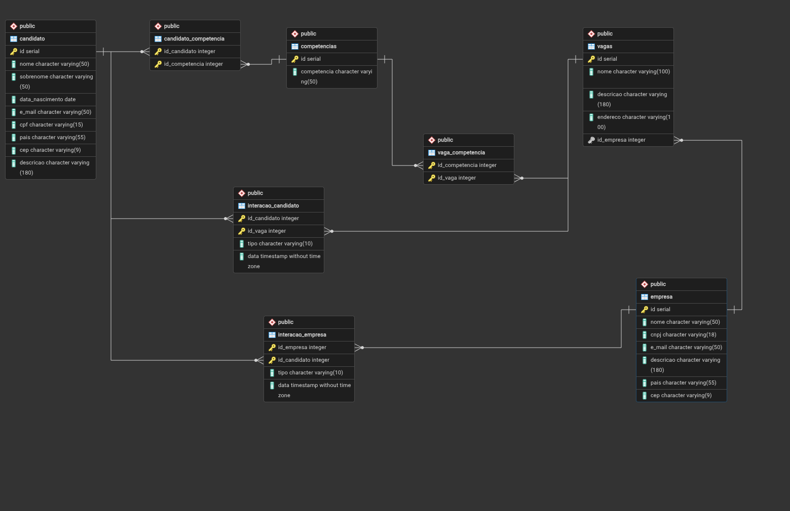

# Linketinder-Project

Projeto **Linketinder**, composto por um backend em **Groovy**, uma interface frontend em **TypeScript** e um banco de dados **PostgreSQL**.

## Tecnologias

- Backend: Groovy 5.1.1, Gradle 9.6.0, PostgreSQL JDBC
- Testes do backend: Spock 2.4 e JUnit Platform
- Frontend: TypeScript, Vite e Chart.js
- Banco de dados: PostgreSQL

## Estrutura

```text
Backend_Linketinder-Groovy/
├── src/main/groovy/org/linketinder/
│   ├── Main.groovy
│   ├── controller/ # navegação e coordenação dos casos de uso
│   ├── database/   # conexão JDBC e tradução de erros do PostgreSQL
│   ├── dao/        # interfaces e implementações JDBC de acesso a dados
│   ├── model/      # modelos de domínio
│   ├── services/   # validações e operações do domínio
│   └── ui/         # views, formulários e entrada/saída do terminal
├── src/main/resources/db.properties
└── src/test/groovy/

Frontend_linketinder-TypeScript/
├── index.html
├── tests/         # regressões dos serviços sem navegador
└── src/
    ├── main.ts
    ├── model/
    ├── repository/
    ├── service/
    ├── ui/
    ├── utils/
    └── style.css

DB_Linketinder/
├── Linketinder_BD.sql
└── modelo_bd.png
```

## Backend

O backend é uma aplicação de terminal em Groovy organizada em MVC, com serviços e persistência em PostgreSQL via JDBC. `Main.groovy` monta as dependências: fábrica de conexões, tradutor de erros, DAOs, serviços, views e controllers. Uma única instância de `ConsoleIO`, com `Scanner` e `PrintStream` injetados, é compartilhada pelas views.

`MenuController` coordena a navegação e apresenta erros de entrada, validação e acesso a dados por meio de `MenuView`. `CandidatoController`, `EmpresaController` e `VagaController` recebem os dados coletados pelas views, constroem as entidades e chamam os serviços. As views de `ui/` coletam e convertem entradas e renderizam os resultados; não chamam serviços ou DAOs. Na edição, os controllers constroem outra entidade para preservar o objeto consultado em caso de falha. As datas usam conversão estrita no formato `dd-MM-yyyy`.

As entidades de `model/` representam os dados sem conter layout de terminal. Os serviços de `services/` aplicam as regras de negócio, como campos obrigatórios e idade mínima, e dependem das interfaces de `dao/`. As implementações JDBC ficam em `dao/jdbc/`; a camada `database/` abre conexões e traduz erros do PostgreSQL. A introdução de MVC preserva essas camadas e suas transações.

A separação foi aplicada em três etapas: compartilhar a entrada/saída do terminal; extrair os controllers e views de candidato, empresa e vaga; e integrar a navegação no `MenuController`, substituindo o menu e os formulários estáticos anteriores.

Os DAOs recebem `IConexaoFactory` pelo construtor; a implementação `ConexaoDB` é escolhida em `Main.groovy`. Candidato e vaga também recebem o mesmo `ICompetenciaDAO` e compartilham a conexão da operação com ele, preservando a transação. O DAO que abre a conexão é responsável por fechá-la ao término da operação.

A tradução de erros de gravação utiliza Strategy: os DAOs recebem `IDatabaseErrorTranslator`, e `Main.groovy` seleciona `PostgresErrorTranslator`. Assim, o tratamento específico do PostgreSQL fica nessa implementação e pode ser substituído sem alterar os DAOs. As inserções recuperam o ID com `getGeneratedKeys()`, solicitando explicitamente a coluna `id` pela API JDBC, sem incluir `RETURNING` no SQL da aplicação. Se a chave não for retornada ou for nula, a operação falha; nos cadastros de candidato, empresa e vaga, a transação é desfeita.

Essas abstrações preparam a troca de banco, mas o esquema e o driver configurados continuam sendo PostgreSQL. Para executar em outro banco, será necessário configurar seu driver e URL, adaptar o esquema e o tradutor de erros e validar as operações nele. O suporte à solicitação de chaves geradas por nome de coluna também deve ser conferido no driver de destino, conforme o [contrato JDBC](https://docs.oracle.com/en/java/javase/17/docs/api/java.sql/java/sql/Connection.html#prepareStatement(java.lang.String,java.lang.String%5B%5D)).

O menu permite listar candidatos, empresas e vagas; cadastrar candidatos, empresas e vagas; atualizar esses registros por ID; excluir registros por ID; e encerrar a aplicação. As listagens exibem os IDs utilizados nas operações. Os serviços validam campos obrigatórios e IDs, e o serviço de candidato também verifica a idade mínima de 18 anos. Candidatos e vagas podem ser associados a competências. Durante a edição, campos vazios mantêm os valores atuais; deixar competências em branco envia `null` à persistência para preservar os vínculos, e informar competências substitui a lista. O fim da entrada do terminal encerra a navegação sem gravar um formulário incompleto.

### Configuração do banco

O esquema PostgreSQL está descrito no script [`DB_Linketinder/Linketinder_BD.sql`](DB_Linketinder/Linketinder_BD.sql). A conexão do backend lê `Backend_Linketinder-Groovy/src/main/resources/db.properties`; configure ali `db.url`, `db.user` e `db.password` para o PostgreSQL local antes de executar. Os valores presentes no arquivo são configuração local de exemplo, não credenciais para produção.

### Como executar

Tenha um JDK compatível com Gradle 9.6 (Java 17 ou superior), PostgreSQL configurado e o esquema criado pelo script SQL. No terminal, entre na pasta do backend:

```bash
cd Backend_Linketinder-Groovy
```

Linux/macOS:

```bash
chmod +x gradlew # caso necessário
./gradlew run
```

Windows:

```bat
gradlew.bat run
```

O programa inicia um menu interativo no terminal. As operações de leitura e gravação dependem de uma conexão válida com o PostgreSQL.

### Testes do backend

As especificações cobrem os serviços de candidato, empresa e vaga, a tradução de erros do PostgreSQL e a injeção da fábrica e do tradutor nos DAOs. Os testes de controllers e views usam entrada/saída em memória e DAOs simulados para verificar cadastro, edição sem mutar o objeto original, exclusão, apresentação, datas inválidas, preservação das competências e navegação após erros ou fim de entrada. Os testes com mocks JDBC verificam fechamento de recursos, transações com competências, recuperação dos IDs gerados e rollback quando uma chave está ausente ou nula:

```bash
./gradlew test
```

No Windows, use `gradlew.bat test`.

## Frontend

A interface web permite que candidatos e empresas criem contas, entrem no sistema e mantenham seus perfis. Candidatos podem apresentar formação e competências; empresas podem cadastrar e remover vagas. O painel da empresa também mostra um gráfico com a quantidade de candidatos por competência.

O frontend foi desenvolvido em **TypeScript**, com **Vite** para desenvolvimento e build, e **Chart.js** para os gráficos. Os dados e a sessão são armazenados no `localStorage` do navegador. A interface funciona de forma independente e, atualmente, não consome o backend Groovy.

Os eventos e a apresentação ficam em `src/main.ts`. O módulo `src/ui/formularios.ts` converte os campos em dados de entrada, controla o envio dos formulários e apresenta erros. As regras ficam nos serviços: `AccountService` cuida do cadastro e exclusão de contas; `AuthService`, da autenticação; `ProfileService`, da atualização de perfis; `VacancyService`, das vagas e da verificação da empresa proprietária; e `CompetencyService`, da contagem de candidatos por competência. `SectionService` mantém a sessão. Esses serviços não dependem do DOM, e o acesso ao armazenamento continua centralizado em `repository/UserRepository.ts`.

### Como executar

Tenha o [Node.js](https://nodejs.org/) e o npm instalados. No terminal, entre na pasta do frontend:

```bash
cd Frontend_linketinder-TypeScript
npm install
npm run dev
```

O Vite exibirá no terminal o endereço local para abrir no navegador. Para gerar a versão de produção ou pré-visualizá-la:

```bash
npm run build
npm run preview
```

### Testes do frontend

Na pasta do frontend, execute:

```bash
npm test
```

Os testes usam o executor nativo do Node.js e o TypeScript já instalado, sem navegador ou dependências adicionais. Cobrem cadastro, autenticação, atualização de perfis, propriedade de vagas, exclusão de contas e contagem de competências, usando armazenamento em memória e arquivos temporários. O comando `npm run build` verifica os tipos e gera a versão de produção.

## Banco de dados

O banco organiza os dados principais do Linketinder em tabelas de candidatos, empresas, vagas e competências. Cada vaga pertence a uma empresa, e tabelas de associação relacionam competências a candidatos e vagas. O modelo também prevê interações de candidatos com vagas e de empresas com candidatos; quando ambos demonstram interesse, a view `MATCHES` identifica o match.

O diagrama abaixo apresenta a estrutura e os relacionamentos entre essas tabelas. O script SQL e a imagem do modelo estão na pasta `DB_Linketinder`.



### Lógica aplicada e funcionamento

As tabelas `candidato` e `empresa` guardam os perfis. Uma empresa pode publicar várias vagas, e cada vaga fica ligada à empresa por `id_empresa`. Como um candidato pode ter várias competências e uma competência pode aparecer em vários perfis, a tabela `candidato_competencia` registra essa relação. A tabela `vaga_competencia` faz o mesmo entre vagas e competências.

As interações são registradas separadamente: `interacao_candidato` relaciona um candidato a uma vaga, enquanto `interacao_empresa` relaciona uma empresa a um candidato. Em ambas, o campo `tipo` aceita `LIKE` ou `DISLIKE`, e a data da ação é registrada automaticamente.

A view `MATCHES` combina essas interações usando o candidato e a empresa da vaga. Ela retorna um match quando o candidato curtiu a vaga e a empresa curtiu o mesmo candidato. Assim, o match representa interesse mútuo.

## Objetivo

Projeto desenvolvido para praticar **Groovy**, **Gradle**, **TypeScript**, **PostgreSQL** e a organização de uma plataforma de conexão entre candidatos e empresas.
